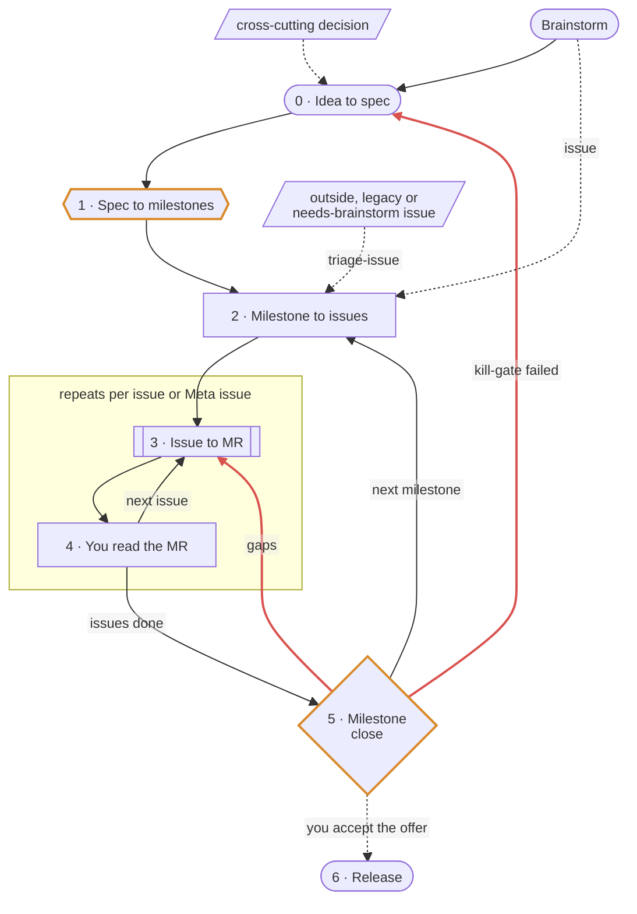

# Dream team workflow

Amber: exit gates. Red: loop-backs from a failed gate. Dotted: side entries and the
release you accept.

## Walkthrough

### Before 0. Brainstorm

- You: "I want a Rust rewrite of a DNS resolver for large public deployments."
- Agent: `brainstorm` asks rounds of numbered questions, each with its recommended answer
  (scale, what is out of scope, how parity is proven), until every decision the idea branches
  into is settled.
- Agent: states the shared understanding and proposes a path: spec, issue, Meta issue, research
  issue, inline edit, or drop.
- You: approve or change the path. The agent acts on it only then.

### 0. Idea to spec (once per project)

- You: `/dream-team:scope-spec`, once you approve a spec path. The agent asks what the chat left
  open, then writes a lean v1 spec on a topic branch.
- You: read the spec, push back until it matches your model, merge it.
- Result: a spec of about 1,500 words, `docs/specs/NNNN-<topic>-design.md` unless the repo's
  `CLAUDE.md` or `AGENTS.md` declares another one.

A spec is only for decisions wider than one issue: the v1 design, a cross-cutting change. Work
that fits one issue gets no spec; a decision made during it is posted on the issue and rewrites
the issue's proposal, or supersedes the issue with a new one when its title or problem no longer
holds. A decision that is hard to reverse, surprising without context and a real trade-off (the
decision-record test) also gets a record in the repo's records folder (`docs/decisions/` by
default), in the same commit as the change it records.

### 1. Spec to milestones

- You: "Cut milestones from the spec."
- Agent: `cut-milestones` drafts milestones with one exit gate each (design review, build test, or
  field evidence), plus the dependency graph. The first milestone is the cheapest proof the approach
  works: M1 kill-gates, "within 5% of the reference resolver's QPS or redesign".
- You: set the numbers (14 days, SERVFAIL ≤1%, val corpus >99%). The agent leaves them as
  placeholders; they are product decisions.
- Result: a ROADMAP table with every milestone and a dependency graph naming which run in
  parallel and what waits on what; tracker milestones, with the exit criterion in each
  description and the due date you set, only for those ready to start, at most 3 open at once.
  The rest stay `planned` rows until their dependencies close and an open slot frees.

A release after the MVP skips the spec: "plan 26.11 around #140". `cut-milestones` drafts
one version milestone, exit "release criteria met and #140 closed", with no ROADMAP row. Backlog
issues join it as they are filed.

### 2. Milestone to issues

- You: "File the issues for M4."
- Agent: writes each issue with `scope-issue` (problem, proposal, done when), sets one kind
  label, `area::` and the milestone. When a proposal would need a guess, it files a `Research:`
  issue (`research`) with questions instead, e.g. one for the canary rollback
  baseline. An issue that cannot start before another closes ends with a `Blocked by #<n>` line.
  A milestone gated on field evidence gets one `Evidence:` issue: what to deploy and where, the
  start date, and how to collect the measurement.
  Work spanning milestones, or waiting on features not built yet, gets one `Meta:` issue
  (`meta`, no milestone; a milestone Meta, below, is set to its milestone): a checklist of child
  issues, plus plain lines naming the feature a piece waits on, outside the Meta. A child is filed
  when its work can start, or when it waits only on sibling children, with one `Blocked by` line
  per sibling.
- You: skim the titles; fix anything missing now.

A bug reported from outside (the dogfood router, a user) enters here too. One the agent files
gets one issue per `scope-issue`, in the milestone it belongs to. One the reporter filed on the
tracker, or any issue not in `scope-issue` form, goes through `triage-issue #N` first:

- It closes the issue when the code already does what it asks or you reject it.
- It tries to reproduce a bug claim, and parks the issue on `workflow::blocked` with questions for
  facts only the reporter knows.
- It asks you the open design or scope choices, then rewrites the body in `scope-issue` form with
  the original report collapsed at the end.

On an issue with `workflow::needs-brainstorm` it runs `brainstorm`'s question rounds on the open
items, rewrites the proposal with your answers and removes the label once no item is left open.

With no argument it lists the untriaged issues, the blocked ones whose reporter replied and the
needs-brainstorm ones.

A vague idea goes through `brainstorm` first. A change you describe in chat enters here when it is
issue-sized: it needs a decision from you, contradicts the spec, adds a component, or needs a lab
check. The agent gives its assessment and offers to file the issue instead of editing. Before
filing, it settles what reading the code can, grills you on an undecided hard-to-reverse choice,
asks you any other open question, milestone included, and writes the answers into the issue. An
issue it finds during other work, such as a craft-it run or a review, it files without asking:
open questions go in the issue as listed items, and the issue gets `workflow::needs-brainstorm`.
It posts a lab or research result for an open issue there as a comment, without asking. Smaller
changes it makes inline.

### 3. Issue to MR (the daily loop)

- You: "what's next in M4?" The agent lists the milestone's open issues without an open
  blocker and proposes one.
- You: "work on #126."
- Agent: `dream-team:craft-it`:
  1. Reads the issue and the project `CLAUDE.md`. Given a `Meta:` issue, it stops and names
     `assemble-meta`.
  2. Triage: an open decision gets a dialog with 2–3 options and their costs. The answer is
     posted on the issue as a comment, and written into the description when it changes the work
     remaining. An answer that passes the decision-record test gets its record in the change's
     commit. A `Blocked by` line naming an open issue stops here, and an untriaged or
     needs-brainstorm issue stops with `triage-issue #N`.
  3. Tier:
     - Research: answers, follow-up issues, and a findings comment on the
       research issue, which closes with no MR. Asked for a file, it writes a note in
       `docs/research/`, by an MR that closes the issue.
     - Light (docs, comments, help text, config, rename, or a small bug fix the agent reproduced
       first): the agent makes the edit inline, runs `gateCommands`, and dispatches one reviewer
       — `dream-team:docs-reviewer` for docs, a `general-purpose` reviewer checking the project's
       reference sources otherwise. Full criteria: craft-it step 2a.
     - Full: implementer, mechanical gate, over-engineering cuts and build-rules fixes, quality
       reviewers, a domain lens that checks the diff against what a change in the project's domain
       must get right, bounded fix rounds that also fix the cheap nits.
     - Both tiers settle reviewer questions before the MR; only those nothing settles reach you,
       in one dialog.
  4. Lab work (perf gate, tests that need root) through `dream-team:lab-runner` on the host the
     repo's `CLAUDE.md` names.
  5. MR: one folded commit per change, description by `scope-mr`, with any floors,
     the diagram and any component table updated in the same MR. ROADMAP status waits for
     `milestone-close`.
  6. Small adjacent fixes found on the way ride in the MR as their own commits; other adjacent
     defects are filed as issues, never left in the MR text.
  7. Watches the MR pipeline: retries a flake once, pushes up to two folded fixes for a real
     failure, else posts a CI hand-back comment on the MR.
- A `Meta:` issue: "assemble-meta #40". The agent runs `dream-team:assemble-meta`: it triages the
  Meta issue and every child before any code, asking all open questions in one batch, builds the
  children up to the gate two at a time, oldest ready child first, each in its own worktree,
  lands each on one integration branch in finish order, reviews and fixes the whole branch once,
  and opens one MR with one commit per change. A child whose run fails is dropped with the
  children it blocks.

  Milestone Meta: two or more non-research issues filed for M4 that can run unattended go under
  one `Meta:` issue set to M4. Asking "file M4's issues under one Meta" does the same, and the
  agent proposes which issues stay off it for you to confirm. "assemble-meta" on it ships them as
  one MR; the issues that need a lab run, credentials or your call run through craft-it, and
  milestone close stays your gate before M5.
- You: check the branch and external-reviewer lines, any assumptions at the top of the report,
  the MR, and any `**Pipeline:**` follow-up.

### 4. You read the MR

- The MR's why and root cause are written for you; this is where you learn the system.
- A fact about how the system works: say "note X" and the agent adds it to the contributor doc
  (`docs/development.md`). What you don't flag, `milestone-close` adds in its docs MR.
- An agent mistake: correct it; the agent adds one line to the untracked `CLAUDE.local.md`. You
  promote lines to the tracked `CLAUDE.md`.
- You: merge, or comment and hand it back.

Steps 3 and 4 repeat per issue. Bugs found on the way become issues in the right milestone.

### 5. Milestone close

- You: "is M4 done?"
- Agent: `milestone-close`:
  1. Checks the exit criterion against evidence (14 days in the field, SERVFAIL ratio from
     `/metrics`), reading the `Evidence:` issue for a field gate. Not met: proposes the gap issues,
     files the ones you approve, and stops. A failed kill-gate proposes no issues: the redesign
     goes back to step 0.
  2. Triage table of open issues: close, move, or blocks-close. You answer in one reply.
     `Meta:` issues stay out of the table; the agent ticks their closed children.
  3. Docs check: the diagram and any component table against the code, specs that need a
     `Superseded by` line, README and `docs/` pages checked by `docs-reviewer` against the
     milestone's merged diff, ROADMAP status for the milestone's merged work, `planned` rows now
     ready to become tracker milestones, facts from its merged MRs that `docs/development.md`
     lacks, `CLAUDE.md` and `CLAUDE.local.md` lines to cut (with the lab host or tool change that
     would fix the gotcha, where one could), and `CLAUDE.local.md` lines to promote to
     `CLAUDE.md`. Each new milestone, cut and promotion is one proposal for you to approve or
     reject; drift fixes, facts and ROADMAP status go straight to the docs MR.
  4. Applies what you approved: moves, one docs MR with `docs-editor`'s drift fixes, the facts
     and the ROADMAP update, milestone closed, and the next milestones created. A proposal that
     changes `CLAUDE.md` holds the docs MR until you answer the proposals.
  5. Ends its report with an offer of the next release (step 6).
- You: the gap issues, the triage table, the new milestones, the cuts, the promotions and the
  release offer are your decisions; the docs MR review covers the rest.

### 6. Release

- Agent: every milestone close report offers the next version in the last release's scheme, as
  `ship-it` computes it: `0.4.0` after `0.3.0`, `26.11.1` after `26.11.0`.
- You: say yes, or name another version; naming one is how a scheme change or a major release
  happens. No reply: no release.
- Agent: runs `ship-it` with that version. It bumps each version file and renames the CHANGELOG
  `[Unreleased]` section to the new version, where they exist, in one commit: in the docs MR
  while it is open, else in an MR of its own. It says it waits for the merge, then pushes a tag
  on the merge commit without asking, unless the project's `CLAUDE.md` forbids tagging. CI
  builds the release from the tag.
- Releases between closes, and releases of a project without milestones, are yours to ask for:
  "cut a release" runs `ship-it`.

## Where your time goes

| Step | Your decision |
|---|---|
| Before 0 | Answer the grilling rounds; approve the path |
| 0 | Approve the spec |
| 1 | Exit criteria and their numbers |
| 2 | Is anything missing from the issue list; design and scope choices `triage-issue` asks |
| 3 | Which issue is next; triage and reviewer-question dialogs, only when a decision is open |
| 4 | Read the MR, note what you learned, merge |
| 5 | Gap issues to file; close or move per leftover issue; new milestones; each cut and promotion; yes or another version to the release offer |
